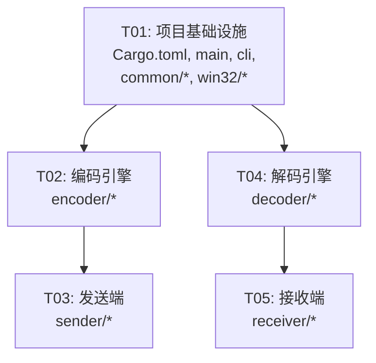

# optrans — 系统设计文档

> **项目**：optrans（Optical Transfer）  
> **目标**：通过屏幕视觉编码在 Horizon 远程桌面两端传输文件  
> **平台**：Windows（兼容 Win7+）  
> **架构师**：Bob  
> **日期**：2025-06-17

---

## 目录

1. [Part A: 系统设计](#part-a-系统设计)
   - [1. 实现方案](#1-实现方案)
   - [2. 文件列表](#2-文件列表)
   - [3. 数据结构与接口](#3-数据结构与接口)
   - [4. 程序调用流程](#4-程序调用流程)
   - [5. 待明确事项](#5-待明确事项)
2. [Part B: 任务分解](#part-b-任务分解)
   - [6. 依赖包列表](#6-依赖包列表)
   - [7. 任务列表](#7-任务列表)
   - [8. 共享知识](#8-共享知识)
   - [9. 任务依赖图](#9-任务依赖图)

---

## Part A: 系统设计

### 1. 实现方案

#### 1.1 核心挑战

| 挑战 | 说明 | 策略 |
|------|------|------|
| **帧定位** | 在屏幕截图中快速找到 3 个 finder pattern | 按 1:1:3:1:1 比例扫描行 + 三中心验证几何关系 |
| **无反馈可靠性** | 接收端无法通知发送端重传 | RS 纠错 + 发送端循环发送多轮 |
| **帧同步** | 区分新帧与旧帧 | 格式信息中的递增帧序号去重 |
| **性能** | 截屏→定位→解码需在帧间隔内完成 | BitBlt 直接从屏幕 DC 取像素，纯内存操作 |
| **模块提取** | 透视变形下的模块采样 | 通过 finder pattern 中心建立仿射变换，网格采样 |

#### 1.2 架构模式

```
┌──────────────────────────────────────────────────────────┐
│                     CLI (clap)                            │
│                  send / receive                           │
├──────────────────────┬───────────────────────────────────┤
│    Sender Pipeline    │        Receiver Pipeline          │
│                       │                                   │
│  文件 → 分块 → RS编码 │  截屏 → 定位 → 提取 → RS解码     │
│        → 帧构建 → 渲染│       → 去重 → 重组 → 校验       │
│             → 窗口显示│                                   │
├──────────────────────┴───────────────────────────────────┤
│              共享层（common / win32 FFI）                  │
└──────────────────────────────────────────────────────────┘
```

**架构选择**：单一 Crate，模块分层，不拆多个 Crate。发送端和接收端共用 encoder/decoder 核心逻辑。

#### 1.3 核心技术选型

| 领域 | 选型 | 理由 |
|------|------|------|
| CLI | `clap` v4 derive | 业界标准，derive 宏减少模板代码 |
| SHA-256 | `sha2` v0.10 | 纯 Rust，no_std 兼容，广泛使用 |
| Reed-Solomon | `reed-solomon` v0.2 | 纯 Rust，支持自定义 RS(n,k) 参数 |
| 屏幕截取 | Win32 `BitBlt` (GDI32) | 零额外依赖，兼容 Win7，直接取像素 |
| 窗口 | Win32 `CreateWindowExW` | 无边框置顶窗口，纯 FFI |
| 图像处理 | **无** | 直接在内存像素缓冲区中操作，不经过图像库 |
| Win32 FFI | 手工 `extern "system"` | 参照 winmm FFI 模式，最小依赖 |

#### 1.4 帧格式详细设计

##### 整体布局

```
┌──────────────────────────────────────────────────────┐
│███████ ←── 格式信息行 0 ──→ ███████│  ← 模块行 0
│█     █ ←── 格式信息行 1 ──→ █     █│  ← 模块行 1
│█ ███ █                      █ ███ █│
│█ ███ █     数 据 矩 阵       █ ███ █│
│█ ███ █                      █ ███ █│
│█     █                      █     █│
│███████                      ███████│
│       ...  更多数据行  ...          │
│███████                      ███████│
│█     █                      █     █│
│█ ███ █                      █ ███ █│
│█ ███ █                      █ ███ █│
│█ ███ █                      █ ███ █│
│█     █                      █     █│
│███████                      ███████│
└──────────────────────────────────────────────────────┘
  ←──── 模块列 0..N-1 ──────→
```

- **Finder Pattern**：三个角各一个 7×7 模块的定位图案（左上、右上、左下），右下角不放
- **格式信息区**：模块行 0 和行 1，位于两个 finder pattern 之间（列 7..N-8）
- **数据矩阵**：其余所有区域

##### 模块尺寸与窗口

| 参数 | 默认值 | 说明 |
|------|--------|------|
| `module_pixels` | 4 | 每模块像素数（正方形） |
| `modules_per_side` | 200 | 每边模块数 |
| 窗口像素 | 800×800 | `module_pixels × modules_per_side` |

##### Finder Pattern 规格（7×7）

```
模块坐标（相对于 pattern 左上角）：

  ███████    行0: 1 1 1 1 1 1 1
  █     █    行1: 1 0 0 0 0 0 1
  █ ███ █    行2: 1 0 1 1 1 0 1
  █ ███ █    行3: 1 0 1 1 1 0 1
  █ ███ █    行4: 1 0 1 1 1 0 1
  █     █    行5: 1 0 0 0 0 0 1
  ███████    行6: 1 1 1 1 1 1 1
```

三个位置：
- **左上 (TL)**：`(0, 0)` — `(6, 6)`
- **右上 (TR)**：`(N-7, 0)` — `(N-1, 6)`
- **左下 (BL)**：`(0, N-7)` — `(6, N-1)`

**检测算法**：水平扫描找 1:1:3:1:1 的黑白交替比例，垂直方向交叉验证，三中心构成近似等腰直角三角形。

##### 格式信息区编码

格式信息占 2 行 × (N-14) 模块。以 N=200 为例：2 × 186 = 372 bits 可用。

原始字段（97 bits）：

| 字段 | 位宽 | 说明 |
|------|------|------|
| `frame_type` | 2 | 0=元数据帧, 1=数据帧, 2=传输结束(EOT) |
| `frame_sequence` | 16 | 帧序号，从 0 递增，接收端用于去重 |
| `block_index` | 32 | 数据块索引（元数据帧/EOT 帧填 0） |
| `total_blocks` | 32 | 总数据块数（仅元数据帧有效） |
| `payload_bytes` | 13 | 载荷字节数（RS 编码前），最大 8191 |
| `reserved` | 2 | 保留，填 0 |

编码流程：
1. 将 97 bits 打包为 13 bytes（最后一个字节的高位填 0）
2. 计算 CRC-16（13 bytes → 15 bytes）
3. **三重重复**：15 bytes × 3 = 45 bytes = 360 bits
4. 填入格式信息区的 372 bits（前 360 bits 为编码数据，剩余 12 bits 用 0 填充）

解码流程：
1. 提取格式信息区所有模块
2. 按 3 份分组多数投票
3. CRC-16 校验

##### 数据矩阵模块排列

**读取顺序**：行优先（row-major），从左到右、从上到下，跳过保留区域（finder patterns + 格式信息区）。

对于模块坐标 `(col, row)`：
- 如果位于 finder pattern 区域内 → 跳过
- 如果位于格式信息区 → 跳过
- 否则 → 按行优先顺序编入数据序列

**比特 → 模块映射**：
- `1` → 黑色模块（`RGB(0, 0, 0)`）
- `0` → 白色模块（`RGB(255, 255, 255)`）

##### Reed-Solomon 编码方案

| 参数 | 值 | 说明 |
|------|-----|------|
| 码字大小 | GF(256) | 一个码字 = 1 byte |
| RS 码 | RS(255, 217) | 217 数据 bytes → 255 总 bytes，38 校验 bytes |
| 冗余率 | ~14.9% | 38/255 ≈ 14.9%，接近 15% 目标 |
| 每 RS 块纠错能力 | 最多 19 字节错误 | |

**数据帧编码**（块大小 4096 bytes）：
```
block_index  u32 (4 bytes) ──┐
block_data   [u8; N]         ├── payload = 4 + N bytes (N ≤ 4096)
                              │
payload ──→ 分成 ceil(payload_len / 217) 个 RS 块
         ──→ 每块 RS(255,217) 编码 → 255 bytes
         ──→ 拼接所有编码块 → encoded_data
         ──→ 写入数据矩阵
```

**元数据帧编码**同理，但 payload 较小（约 300 bytes），用 2 个 RS 块。

##### 传输结束（EOT）信号

EOT 帧特征：
- `frame_type = 2`
- `frame_sequence` 正常递增
- `block_index = 0`, `total_blocks = 0`
- `payload_bytes = 0`（无载荷数据矩阵）
- 发送端连续发送 **3 轮** EOT（每轮 1 帧，间隔正常帧时长）

接收端行为：
- 收到 EOT 帧 → 检查是否已收到所有数据块
  - 是 → 开始文件重组与 SHA-256 校验
  - 否 → 继续等待（发送端循环中可能重发缺失帧）
- 收到第 2 个 EOT（同 seq） → 去重忽略
- 超时（如 5 秒无新帧）→ 强制以现有数据重组

---

### 2. 文件列表

```
optrans/
├── Cargo.toml
├── src/
│   ├── main.rs                  # 程序入口，解析 CLI 后 dispatch
│   ├── lib.rs                   # crate 根，声明所有模块
│   ├── cli.rs                   # clap CLI 参数定义 (SendArgs / ReceiveArgs)
│   ├── common/
│   │   ├── mod.rs               # common 模块导出
│   │   ├── types.rs             # 共享数据类型 (FormatInfo, MetaPayload, Frame, BlockData 等)
│   │   ├── constants.rs         # 全局常量 (模块尺寸、RS参数、窗口默认值等)
│   │   └── error.rs             # 统一错误类型 (OptransError enum)
│   ├── encoder/
│   │   ├── mod.rs               # encoder 模块导出
│   │   ├── pattern.rs           # Finder pattern 生成 + 格式信息编码
│   │   ├── reed_solomon.rs      # RS(255,217) 编码封装
│   │   ├── frame.rs             # 帧构建（组装元数据帧/数据帧/EOT帧）
│   │   └── render.rs            # 帧 → 像素缓冲区渲染
│   ├── sender/
│   │   ├── mod.rs               # sender 模块导出
│   │   ├── chunker.rs           # 文件读取、SHA-256 计算、分块
│   │   ├── window.rs            # Win32 无边框置顶窗口 (创建/销毁/绘制)
│   │   └── transmit.rs          # 发送编排（循环显示帧序列）
│   ├── decoder/
│   │   ├── mod.rs               # decoder 模块导出
│   │   ├── locate.rs            # 帧定位（三 finder pattern 检测 + 几何验证）
│   │   ├── extract.rs           # 模块提取（仿射变换 + 网格采样）
│   │   ├── reed_solomon.rs      # RS(255,217) 解码封装
│   │   └── decode.rs            # 比特解码（格式信息解码 + 数据载荷解码）
│   ├── receiver/
│   │   ├── mod.rs               # receiver 模块导出
│   │   ├── capture.rs           # GDI BitBlt 屏幕截取 → 像素缓冲区
│   │   ├── collect.rs           # 帧收集与去重（SeqNum 去重 + 乱序缓存）
│   │   └── reassemble.rs        # 文件重组与 SHA-256 校验
│   └── win32/
│       ├── mod.rs               # win32 模块导出
│       ├── ffi.rs               # Win32 FFI extern 声明 (kernel32, user32, gdi32)
│       └── helpers.rs           # Win32 辅助函数 (宽字符串转换、错误处理)
```

**文件总数**：24 个源文件 + 1 个 Cargo.toml = 25 个文件

---

### 3. 数据结构与接口

#### 3.1 类图（Mermaid classDiagram）

参见独立文件 [class-diagram.mermaid](./class-diagram.mermaid)

核心结构：

| 结构体 | 模块 | 职责 |
|--------|------|------|
| `FormatInfo` | common::types | 格式信息（97 bits 的逻辑表示） |
| `MetaPayload` | common::types | 元数据帧载荷 |
| `Frame` | encoder::frame | 构建完成的帧（含格式信息 + 编码后数据） |
| `BlockData` | common::types | 单个文件块 (index + data) |
| `FileManifest` | sender::chunker | 文件元信息（路径、大小、SHA-256、块列表） |
| `SenderWindow` | sender::window | 无边框置顶窗口句柄与状态 |
| `SenderSession` | sender::transmit | 发送会话状态机 |
| `FrameLocation` | decoder::locate | 定位到的帧（三 finder pattern 像素坐标） |
| `DecodedFrame` | decoder::decode | 解码完成的帧（类型 + 载荷） |
| `ScreenCapture` | receiver::capture | 屏幕截取上下文 |
| `FrameCollector` | receiver::collect | 帧收集去重器 |
| `FileAssembler` | receiver::reassemble | 文件重组器 |
| `OptransError` | common::error | 统一错误枚举 |

#### 3.2 关键接口

**编码器接口**：
```rust
// encoder/frame.rs
impl Frame {
    /// 构建元数据帧
    pub fn new_metadata(manifest: &FileManifest, seq: u16) -> Result<Frame>;
    /// 构建数据帧
    pub fn new_data(block: &BlockData, seq: u16, total: u32) -> Result<Frame>;
    /// 构建 EOT 帧
    pub fn new_eot(seq: u16) -> Result<Frame>;
}

// encoder/render.rs
pub fn render_frame(frame: &Frame, module_pixels: u32) -> Vec<u8>;
// 返回 RGBA 像素缓冲区，尺寸 = (modules_per_side × module_pixels)²
```

**解码器接口**：
```rust
// decoder/locate.rs
pub fn locate_frame(pixels: &[u8], width: i32, height: i32) -> Option<FrameLocation>;

// decoder/decode.rs
pub fn decode_format_info(pixels: &[u8], loc: &FrameLocation) -> Result<FormatInfo>;
pub fn decode_payload(pixels: &[u8], loc: &FrameLocation, info: &FormatInfo) -> Result<Vec<u8>>;

// decoder/reed_solomon.rs
pub fn rs_decode(encoded: &[u8], data_len: usize) -> Result<Vec<u8>>;
```

**发送端接口**：
```rust
// sender/chunker.rs
pub fn read_file(path: &Path) -> Result<FileManifest>;

// sender/transmit.rs
pub fn run_send(args: SendArgs) -> Result<()>;
```

**接收端接口**：
```rust
// receiver/capture.rs
pub fn capture_screen() -> Result<(Vec<u8>, i32, i32)>;  // (pixels, width, height)

// receiver/collect.rs
impl FrameCollector {
    pub fn new() -> Self;
    pub fn ingest(&mut self, frame: DecodedFrame) -> Result<IngestResult>;
}

// receiver/reassemble.rs
impl FileAssembler {
    pub fn new(meta: MetaPayload) -> Self;
    pub fn add_block(&mut self, index: u32, data: Vec<u8>) -> Result<()>;
    pub fn finalize(self) -> Result<Vec<u8>>;
}
```

---

### 4. 程序调用流程

#### 4.1 发送流程

```
$ optrans send ./bigfile.bin --module-pixels 4 --rounds 3

main()
  └─→ cli::parse() → SendArgs { path, module_pixels, rounds }
  └─→ sender::transmit::run_send(args)
        ├─→ chunker::read_file(path)
        │     ├─ 读取文件内容
        │     ├─ sha2::Sha256::digest() → SHA-256
        │     └─ 按 block_size=4096 分块 → FileManifest
        │
        ├─→ encoder::frame::Frame::new_metadata(manifest, seq=0)
        │     ├─→ encoder::pattern::encode_format_info(FormatInfo { type=Meta, .. })
        │     └─→ encoder::reed_solomon::rs_encode(payload)
        │
        ├─→ window::SenderWindow::create(800, 800)
        │     └─→ win32 FFI: RegisterClassExW → CreateWindowExW(WS_EX_TOPMOST)
        │
        ├─→ [外层循环 rounds 次]
        │     ├─→ render_and_show(metadata_frame)
        │     │     └─→ encoder::render::render_frame() → 像素缓冲区
        │     │     └─→ window::update_bitmap() → 窗口重绘
        │     │     └─→ sleep(frame_interval_ms)
        │     │
        │     └─→ for each block in manifest.blocks:
        │           ├─→ Frame::new_data(block, seq++, total)
        │           └─→ render_and_show(data_frame)
        │
        ├─→ [发送 EOT 帧 3 次]
        │     └─→ Frame::new_eot(seq++) → render_and_show()
        │
        └─→ window::destroy()
```

#### 4.2 接收流程

```
$ optrans receive ./output.bin

main()
  └─→ cli::parse() → ReceiveArgs { output, timeout_secs }
  └─→ receiver 主循环
        ├─→ collector = FrameCollector::new()
        ├─→ assembler = None
        │
        └─→ loop:
              ├─→ capture::capture_screen()
              │     └─→ win32 FFI: GetDC(NULL) → CreateCompatibleDC → BitBlt → GetDIBits
              │     └─→ 返回 (pixels, screen_w, screen_h)
              │
              ├─→ decoder::locate::locate_frame(pixels, w, h)
              │     ├─→ 水平扫描找 1:1:3:1:1 比例 → finder pattern 候选
              │     ├─→ 垂直验证 + 三中心几何约束
              │     └─→ 返回 FrameLocation { tl, tr, bl } 或 None
              │
              ├─→ if found:
              │     ├─→ decoder::decode::decode_format_info(pixels, loc)
              │     │     ├─→ decoder::extract::extract_format_modules(pixels, loc)
              │     │     └─→ 三重重复解码 + CRC-16 验证
              │     │
              │     └─→ collector.ingest(FormatInfo)
              │           ├─→ if seq 已见过 → 跳过
              │           ├─→ if frame_type == Meta:
              │           │     ├─→ decoder::decode::decode_payload() + RS 解码
              │           │     └─→ assembler = FileAssembler::new(meta)
              │           ├─→ if frame_type == Data:
              │           │     ├─→ decoder::decode::decode_payload() + RS 解码
              │           │     └─→ assembler.add_block(index, data)
              │           └─→ if frame_type == EOT:
              │                 ├─→ if assembler.has_all_blocks():
              │                 │     └─→ break
              │                 └─→ else: continue waiting
              │
              └─→ if timeout: break
        │
        └─→ assembler.finalize()
              ├─→ 按 block_index 排序拼接
              ├─→ SHA-256 校验
              └─→ 写入输出文件
```

#### 4.3 帧检测与解码流程（时序图详细版）

参见独立文件 [sequence-diagram.mermaid](./sequence-diagram.mermaid)

---

### 5. 待明确事项

| # | 事项 | 假设 | 影响 |
|---|------|------|------|
| 1 | **帧间隔时间** | 默认 150ms/帧 | 发送速度和截屏频率的平衡。太快接收端丢帧，太慢传输效率低 |
| 2 | **发送轮数** | 默认 3 轮完整循环 | 无反馈下的可靠性保障。轮数越多越可靠但越慢 |
| 3 | **接收端超时** | 默认 5 秒无新帧即超时 | EOT 检测失败时的兜底策略 |
| 4 | **多显示器支持** | P0 仅限主显示器 | 截屏和窗口定位都以主显示器为准 |
| 5 | **窗口关闭方式** | 按 ESC 键关闭发送窗口 | 需要有优雅的退出机制 |
| 6 | **文件名校验** | UTF-8 编码，最大 255 字节 | 非 UTF-8 路径需转为 UTF-8（或报错） |
| 7 | **模块尺寸范围** | 2–8 像素（仅偶数） | 太小截屏采样困难，太大窗口尺寸过大 |
| 8 | **截屏区域** | 固定截取屏幕左上角 800×800 | 与发送窗口默认位置一致。可配置偏移？ |

---

## Part B: 任务分解

### 6. 依赖包列表

```toml
[dependencies]
clap = { version = "4", features = ["derive"] }
# 用途：CLI 参数解析，send/receive 子命令
# 大小：轻量，仅 derive 宏增加编译时间

sha2 = "0.10"
# 用途：文件 SHA-256 哈希计算与校验
# 大小：纯 Rust，no_std 兼容，约 50KB 编译产物增量

reed-solomon = "0.2"
# 用途：Reed-Solomon RS(255,217) 编解码
# 大小：纯 Rust，约 30KB

# 无 windows-sys 依赖 — 全部 Win32 API 通过手工 extern "system" FFI 调用
```

**Cargo.toml 完整内容**：
```toml
[package]
name = "optrans"
version = "0.1.0"
edition = "2021"

[[bin]]
name = "optrans"
path = "src/main.rs"

[dependencies]
clap = { version = "4", features = ["derive"] }
sha2 = "0.10"
reed-solomon = "0.2"

[profile.release]
opt-level = 3
lto = true
```

### 7. 任务列表

---

#### T01: 项目基础设施

| 属性 | 内容 |
|------|------|
| **Task ID** | T01 |
| **优先级** | P0 |
| **依赖** | 无 |

**涉及文件** (11 个)：
```
Cargo.toml
src/main.rs
src/lib.rs
src/cli.rs
src/common/mod.rs
src/common/types.rs
src/common/constants.rs
src/common/error.rs
src/win32/mod.rs
src/win32/ffi.rs
src/win32/helpers.rs
```

**工作内容**：
1. `Cargo.toml`：配置 package、依赖、profile
2. `src/main.rs`：程序入口，调用 `cli::parse()` 并 dispatch 到 sender/receiver
3. `src/lib.rs`：声明所有模块 `pub mod common; pub mod encoder; ...`
4. `src/cli.rs`：定义 `SendArgs` 和 `ReceiveArgs`，使用 clap derive，含 `send`/`receive` 子命令
5. `src/common/types.rs`：定义所有共享数据类型：
   - `FormatInfo` struct（含 `FrameType` enum）
   - `MetaPayload` struct
   - `BlockData` struct
   - `OptransResult<T>` type alias
6. `src/common/constants.rs`：全局常量：
   - `MODULE_PIXELS_DEFAULT: u32 = 4`
   - `MODULES_PER_SIDE_DEFAULT: u32 = 200`
   - `BLOCK_SIZE: usize = 4096`
   - `RS_DATA_LEN: usize = 217`
   - `RS_PARITY_LEN: usize = 38`
   - `RS_TOTAL_LEN: usize = 255`
   - `FRAME_INTERVAL_MS: u64 = 150`
   - `DEFAULT_ROUNDS: u32 = 3`
   - `EOT_REPEAT: u32 = 3`
   - `RECEIVE_TIMEOUT_SECS: u64 = 5`
7. `src/common/error.rs`：`OptransError` enum（IO、FFI、Decode、Checksum、FrameSync 等变体）
8. `src/win32/ffi.rs`：手工 `extern "system"` 声明所有需要的 Win32 API：
   - `kernel32`: `GetModuleHandleW`, `GetLastError`
   - `user32`: `RegisterClassExW`, `CreateWindowExW`, `ShowWindow`, `UpdateWindow`, `GetMessageW`, `PeekMessageW`, `TranslateMessage`, `DispatchMessageW`, `BeginPaint`, `EndPaint`, `SetWindowPos`, `DestroyWindow`, `PostQuitMessage`, `DefWindowProcW`, `GetSystemMetrics`, `GetDC`, `ReleaseDC`, `GetClientRect`, `GetWindowDC`, `CreateCompatibleDC`, `DeleteDC`, `CreateCompatibleBitmap`, `SelectObject`, `DeleteObject`, `BitBlt`, `GetDIBits`, `SetDIBitsToDevice`, `CreateDIBSection`, `LoadImageW`, `SetWindowLongPtrW`, `GetWindowLongPtrW`, `GetMonitorInfoW`, `MonitorFromWindow`
   - `gdi32`: `CreateSolidBrush`, `FillRect`, `DeleteObject`
   - 以及必要的类型别名：`HWND`, `HDC`, `HBITMAP`, `HINSTANCE`, `LPARAM`, `WPARAM`, `LRESULT`, `BOOL`, `DWORD`, `UINT`, `LONG`, `WORD`, `BYTE`, `ATOM`, `COLORREF`, `RECT`, `POINT`, `SIZE`, `MSG`, `WNDCLASSEXW`, `BITMAPINFOHEADER`, `BITMAPINFO`, `RGBQUAD`, `PAINTSTRUCT`, `MONITORINFO`, `MONITORINFOEXW`
9. `src/win32/helpers.rs`：辅助函数：
   - `to_wide(s: &str) -> Vec<u16>` — 字符串转 UTF-16
   - `from_wide(ptr: *const u16) -> String` — UTF-16 → String
   - `last_error() -> String` — GetLastError → 可读信息
   - `check_hwnd(hwnd: HWND) -> Result<HWND>` — 窗口句柄有效性检查

**输出验证**：`cargo check` 通过，`optrans --help` 显示 send/receive 子命令。

---

#### T02: 编码引擎

| 属性 | 内容 |
|------|------|
| **Task ID** | T02 |
| **优先级** | P0 |
| **依赖** | T01 |

**涉及文件** (5 个)：
```
src/encoder/mod.rs
src/encoder/pattern.rs
src/encoder/reed_solomon.rs
src/encoder/frame.rs
src/encoder/render.rs
```

**工作内容**：
1. `src/encoder/pattern.rs`：
   - `generate_finder_pattern() -> [[u8; 7]; 7]` — 返回 7×7 的 finder pattern 模块矩阵
   - `encode_format_info(info: &FormatInfo) -> Vec<u8>` — 97 bits → CRC-16 → 三重重复 → 360 bits
   - `get_format_module(col, row, info_bits) -> u8` — 给定模块坐标，返回格式信息中该位的值
   - `is_finder_module(col, row, n) -> bool` — 判断模块坐标是否在 finder pattern 区域内
   - `is_format_module(col, row, n) -> bool` — 判断是否在格式信息区
2. `src/encoder/reed_solomon.rs`：
   - `rs_encode(data: &[u8]) -> Result<Vec<u8>>` — RS(255,217) 编码
     - 将输入分成 ceil(len/217) 个块，每块编码为 255 bytes
     - 输出格式：`[4 bytes total_data_len LE] + [各 RS 块拼接]`
   - 或封装为 `RsEncoder` struct 含 `new()` 和 `encode_block()` 方法
3. `src/encoder/frame.rs`：
   - `Frame` struct：`format_info: FormatInfo`, `payload: Vec<u8>`（RS 编码后）
   - `Frame::new_metadata(manifest, seq) -> Result<Frame>` — 构建元数据帧
   - `Frame::new_data(block, seq, total) -> Result<Frame>` — 构建数据帧
   - `Frame::new_eot(seq) -> Result<Frame>` — 构建 EOT 帧（空载荷）
4. `src/encoder/render.rs`：
   - `render_frame(frame, module_pixels, modules_per_side) -> Vec<u8>` — 渲染为 RGBA 像素缓冲区
     - 尺寸：`(module_pixels * modules_per_side)² × 4 bytes`
     - 遍历每个模块坐标，确定颜色（黑/白），填充对应像素块
     - 黑色：`[0, 0, 0, 255]`，白色：`[255, 255, 255, 255]`

**输出验证**：单元测试验证 RS 编码往返、帧构建→渲染可复现。

---

#### T03: 发送端

| 属性 | 内容 |
|------|------|
| **Task ID** | T03 |
| **优先级** | P0 |
| **依赖** | T01, T02 |

**涉及文件** (4 个)：
```
src/sender/mod.rs
src/sender/chunker.rs
src/sender/window.rs
src/sender/transmit.rs
```

**工作内容**：
1. `src/sender/chunker.rs`：
   - `FileManifest` struct：`path`, `file_name: String`, `file_size: u64`, `sha256: [u8; 32]`, `blocks: Vec<BlockData>`
   - `read_file(path: &Path) -> Result<FileManifest>` — 打开文件、SHA-256 分块计算、按 4096 分块
2. `src/sender/window.rs`：
   - `SenderWindow` struct：`hwnd: HWND`, `width: i32`, `height: i32`, `bitmap_buffer: Vec<u8>`
   - `SenderWindow::create(w, h) -> Result<Self>` — 注册窗口类 + 创建 WS_EX_TOPMOST 无边框窗口
   - `SenderWindow::update_bitmap(&mut self, pixels: &[u8])` — 更新像素缓冲区
   - `SenderWindow::show(&mut self)` — 显示窗口，触发 WM_PAINT
   - `SenderWindow::paint(&self, ps: &PAINTSTRUCT)` — WM_PAINT 处理：SetDIBitsToDevice
   - `SenderWindow::process_messages() -> bool` — PeekMessage 循环，ESC 键退出
   - `impl Drop for SenderWindow` — DestroyWindow
3. `src/sender/transmit.rs`：
   - `run_send(args: SendArgs) -> Result<()>` — 发送主控：
     1. `chunker::read_file()` → manifest
     2. `Frame::new_metadata()` → metadata_frame
     3. `SenderWindow::create()`
     4. 循环 `args.rounds` 次：
        - 渲染并显示 metadata_frame → sleep(FRAME_INTERVAL_MS)
        - 对每个 block：`Frame::new_data()` → render → show → sleep
     5. EOT 帧 × `EOT_REPEAT` 次
     6. 窗口保持显示直到按键退出

**输出验证**：能成功运行 `optrans send <file>`，窗口显示在屏幕左上角。

---

#### T04: 解码引擎

| 属性 | 内容 |
|------|------|
| **Task ID** | T04 |
| **优先级** | P0 |
| **依赖** | T01 |

**涉及文件** (5 个)：
```
src/decoder/mod.rs
src/decoder/locate.rs
src/decoder/extract.rs
src/decoder/reed_solomon.rs
src/decoder/decode.rs
```

**工作内容**：
1. `src/decoder/locate.rs`：
   - `FinderPattern` struct：`center: (f64, f64)`, `module_size: f64`
   - `FrameLocation` struct：`tl: FinderPattern`, `tr: FinderPattern`, `bl: FinderPattern`, `modules_per_side: u32`
   - `locate_frame(pixels: &[u8], width: i32, height: i32) -> Option<FrameLocation>`：
     - 水平扫描行，找 1:1:3:1:1 的黑白交替比例（连续 5 段）
     - 垂直方向交叉验证
     - 收集 finder pattern 候选中心
     - 三中心几何约束（TL→TR ≈ TL→BL 距离，TR→BL ≈ TL→TR × √2）
2. `src/decoder/extract.rs`：
   - `extract_format_modules(pixels, loc) -> Vec<u8>` — 从格式信息区提取 372 个模块的比特值
   - `extract_data_modules(pixels, loc, info) -> Vec<u8>` — 从数据矩阵提取模块比特值
   - 通过 finder pattern 中心建立仿射变换，网格采样
3. `src/decoder/reed_solomon.rs`：
   - `rs_decode_data(encoded: &[u8]) -> Result<Vec<u8>>` — RS(255,217) 解码
     - 解析 `[4 bytes total_len] + [RS blocks...]`
     - 每个 RS 块解码：255 bytes → 217 bytes
     - 拼接，截取 total_len
4. `src/decoder/decode.rs`：
   - `DecodedFrame` struct：`frame_type: FrameType`, `seq: u16`, `block_index: u32`, `total_blocks: u32`, `payload: Vec<u8>`
   - `decode_format_info(pixels, loc) -> Result<FormatInfo>` — 提取 + 三重投票 + CRC 校验
   - `decode_frame(pixels, loc) -> Result<DecodedFrame>` — 完整解码一个帧
   - `decode_payload(pixels, loc, info) -> Result<Vec<u8>>` — RS 解码载荷

**输出验证**：单元测试：给定已知像素图案，能正确定位和解码。

---

#### T05: 接收端

| 属性 | 内容 |
|------|------|
| **Task ID** | T05 |
| **优先级** | P0 |
| **依赖** | T01, T04 |

**涉及文件** (4 个)：
```
src/receiver/mod.rs
src/receiver/capture.rs
src/receiver/collect.rs
src/receiver/reassemble.rs
```

**工作内容**：
1. `src/receiver/capture.rs`：
   - `ScreenCapture` struct（可选，保持状态）
   - `capture_screen(x, y, w, h) -> Result<(Vec<u8>, i32, i32)>` — 截取屏幕区域：
     - `GetDC(NULL)` → 屏幕 DC
     - `CreateCompatibleDC` + `CreateCompatibleBitmap` → 内存 DC + 位图
     - `BitBlt(SRCCOPY)` → 拷贝屏幕到位图
     - `GetDIBits` → 提取 RGBA 像素到 Vec<u8>
     - 清理：`DeleteObject`, `DeleteDC`, `ReleaseDC`
     - 返回 `(pixels_rgba, width, height)`
2. `src/receiver/collect.rs`：
   - `IngestResult` enum：`NewMeta`, `NewData(u32)`, `EotReceived`, `Duplicate`, `Invalid`
   - `FrameCollector` struct：`seen_seqs: HashSet<u16>`, `meta: Option<MetaPayload>`, `data_blocks: HashMap<u32, Vec<u8>>`, `total_blocks: u32`
   - `FrameCollector::new() -> Self`
   - `FrameCollector::ingest(&mut self, frame: DecodedFrame) -> Result<IngestResult>`：
     - 检查 `seen_seqs` 去重
     - 根据 frame_type 分派：Meta → 存储元数据；Data → 存储数据块；EOT → 返回 EotReceived
   - `FrameCollector::is_complete(&self) -> bool`
   - `FrameCollector::missing_blocks(&self) -> Vec<u32>`
3. `src/receiver/reassemble.rs`：
   - `FileAssembler` struct：`meta: MetaPayload`, `blocks: HashMap<u32, Vec<u8>>`
   - `FileAssembler::new(meta: MetaPayload) -> Self`
   - `FileAssembler::add_block(&mut self, index: u32, data: Vec<u8>)`
   - `FileAssembler::finalize(self) -> Result<Vec<u8>>`：
     - 按 index 排序拼接所有块
     - SHA-256 校验
     - 返回完整文件内容
4. `src/receiver/mod.rs`：
   - `run_receive(args: ReceiveArgs) -> Result<()>` — 接收主循环
   - 初始化 collector，循环截屏→定位→解码→collector.ingest()
   - EOT 收到 + 完整 → 退出循环
   - 超时 → 以现有数据 finalize
   - 写入输出文件

**输出验证**：端到端测试：`optrans send test.bin` + `optrans receive out.bin`，文件 SHA-256 一致。

---

### 8. 共享知识

#### 8.1 错误处理策略

```rust
// common/error.rs
#[derive(Debug)]
pub enum OptransError {
    Io(std::io::Error),
    Win32(String),
    FrameDecode(String),
    RsDecode(String),
    ChecksumMismatch { expected: String, actual: String },
    IncompleteTransfer { missing: Vec<u32> },
    InvalidFormatInfo(String),
    NoFrameFound,
    Timeout,
}

impl From<std::io::Error> for OptransError { ... }
impl std::fmt::Display for OptransError { ... }
impl std::error::Error for OptransError { ... }

pub type OptransResult<T> = Result<T, OptransError>;
```

- **所有公共 API 返回 `OptransResult<T>`**
- Win32 错误通过 `GetLastError()` + `FormatMessageW` 转为字符串
- IO 错误自动 From 转换
- **禁止 `.unwrap()` 在生产路径中使用** — 全部用 `?` 传播

#### 8.2 常量定义位置

**所有常量集中在 `src/common/constants.rs`**，禁止在其它文件中定义魔法数字：

```rust
pub const MODULE_PIXELS_DEFAULT: u32 = 4;
pub const MODULES_PER_SIDE_DEFAULT: u32 = 200;
pub const BLOCK_SIZE: usize = 4096;
pub const RS_DATA_LEN: usize = 217;
pub const RS_PARITY_LEN: usize = 38;
pub const RS_TOTAL_LEN: usize = 255;
pub const FRAME_INTERVAL_MS: u64 = 150;
pub const DEFAULT_ROUNDS: u32 = 3;
pub const EOT_REPEAT: u32 = 3;
pub const RECEIVE_TIMEOUT_SECS: u64 = 5;
pub const FINDER_SIZE: u32 = 7;
pub const FORMAT_ROWS: u32 = 2;
pub const MAX_FILE_NAME_LEN: usize = 255;
```

#### 8.3 像素缓冲区格式

- 格式：**RGBA**（4 bytes/pixel），行优先
- 索引：`pixels[(y * width + x) * 4 + channel]`
- channel 0 = R, 1 = G, 2 = B, 3 = A
- 黑色：`[0, 0, 0, 255]`
- 白色：`[255, 255, 255, 255]`
- 窗口位图与截屏缓冲区**使用相同格式**，便于比较和调试

#### 8.4 命名规范

| 类型 | 规范 | 示例 |
|------|------|------|
| 文件名 | `snake_case` | `reed_solomon.rs`, `format_info` |
| 结构体/枚举 | `PascalCase` | `FormatInfo`, `FrameCollector` |
| 函数/方法 | `snake_case` | `locate_frame()`, `rs_encode()` |
| 常量 | `SCREAMING_SNAKE_CASE` | `BLOCK_SIZE`, `FRAME_INTERVAL_MS` |
| 模块 | `snake_case` | `pub mod reed_solomon;` |

#### 8.5 关键约定

- **帧序号**：从 0 开始单调递增，整个传输过程（含元数据帧和 EOT 帧）共用一个计数器
- **块序号**：从 0 开始，最大 `u32::MAX`（4 bytes），理论支持 16TB 文件
- **模块比特值**：`1` = 黑色，`0` = 白色（编码和解码必须一致）
- **字节序**：所有多字节整数采用 **小端序**（Little Endian）
- **RS 编码输出格式**：`[4 bytes total_data_len LE] + [ceil(total/217) × 255 bytes RS blocks]`
- **元数据帧的 block_index 和 total_blocks**：填 0（因为元数据帧不属于数据块序列）
- **EOT 帧**：block_index=0, total_blocks=0, payload_bytes=0（数据矩阵为空/填 0）

---

### 9. 任务依赖图



依赖说明：
- T02 和 T04 **可并行开发**（分别依赖 T01，互不依赖）
- T03 依赖 T02（需要编码引擎构建帧）
- T05 依赖 T04（需要解码引擎解析帧）

**建议执行顺序**：T01 → T02 + T04（并行）→ T03 + T05（并行）

---

*文档结束*
