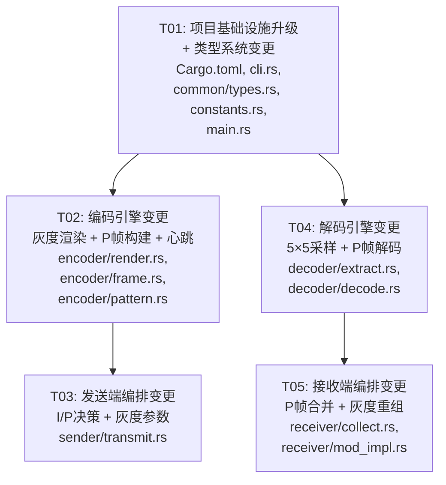

# optrans v0.2 增量架构设计

> **文档类型**：增量设计（仅描述 v0.1 → v0.2 变更）  
> **作者**：Bob（架构师）  
> **日期**：2025-06-18  
> **基线**：v0.1 系统设计 `docs/system_design.md`  
> **依赖**：增量 PRD `docs/prd_v0.2_incremental.md`

---

## 目录

1. [Part A: 增量系统设计](#part-a-增量系统设计)
   - [1. 架构变更总览](#1-架构变更总览)
   - [2. 核心算法设计](#2-核心算法设计)
   - [3. 数据结构与接口变更](#3-数据结构与接口变更)
   - [4. 程序调用流变更](#4-程序调用流变更)
   - [5. 关键常量](#5-关键常量)
2. [Part B: 增量任务分解](#part-b-增量任务分解)
   - [6. 依赖包变更](#6-依赖包变更)
   - [7. 任务列表](#7-任务列表)
   - [8. 共享知识](#8-共享知识)
   - [9. 任务依赖图](#9-任务依赖图)
3. [6. 待明确事项](#10-待明确事项)

---

## Part A: 增量系统设计

### 1. 架构变更总览

#### 1.1 新增/修改文件清单

```
修改的文件（11 个）：
├── Cargo.toml                         # edition 2024, version 0.2.0, 依赖改为 "*"
├── src/
│   ├── cli.rs                         # 新增 --gray-levels, --no-diff, --no-heartbeat,
│   │                                  #   --i-frame-interval, --encoding-mode
│   ├── main.rs                        # dispatch 时传递新参数
│   ├── common/
│   │   ├── types.rs                   # FormatInfo.reserved 语义化, FrameKind, EncodingMode,
│   │   │                              #   GrayEncodingConfig, DecodedFrame 增加字段
│   │   └── constants.rs               # 灰度值表, 解码阈值, 心跳/差分常量
│   ├── encoder/
│   │   ├── frame.rs                   # P 帧构建, Frame struct 增加 frame_kind 字段
│   │   ├── render.rs                  # 灰度渲染, 心跳注入, P 帧背景填充
│   │   └── pattern.rs                 # （微小变更）format_info 编码适配 reserved 语义
│   ├── sender/
│   │   └── transmit.rs                # I/P 帧决策, 灰度参数传递, 心跳控制
│   ├── decoder/
│   │   ├── decode.rs                  # P 帧载荷解码, encoding_mode 自动检测
│   │   └── extract.rs                 # 灰度多级分类器, 5×5 中值采样

新增的文件（0 个）：
（所有灰度/差分逻辑都在现有文件中实现，不新增模块文件）
```

**不改的文件（不变）**：
- `src/encoder/reed_solomon.rs` — RS 编码逻辑不变
- `src/decoder/reed_solomon.rs` — RS 解码逻辑不变
- `src/decoder/locate.rs` — Finder pattern 检测逻辑不变
- `src/sender/chunker.rs` — 文件分块逻辑不变
- `src/sender/window.rs` — 窗口管理不变
- `src/receiver/capture.rs` — GDI 截屏不变
- `src/receiver/reassemble.rs` — 文件重组不变
- `src/receiver/mod_impl.rs` — 仅微小变更（传递新参数）
- `src/win32/` — Win32 FFI 完全不变

#### 1.2 数据流变化

```
v0.1 (全二值 + 全 I 帧):
  sender: 文件 → 分块 → RS编码 → 帧构建 → 二值渲染 → 窗口
  receiver: 截屏 → 定位 → 二值采样(3×3均值+阈值128) → RS解码 → 去重 → 重组

v0.2 (灰度 + I/P 帧 + 心跳):
  sender: 文件 → 分块 → RS编码 → 帧构建(I/P决策) ──→ 灰度渲染(+心跳) → 窗口
                                              │
                                              └→ I帧缓存(用于P帧diff)
  
  receiver: 截屏 → 定位 → 灰度采样(5×5中值+多级分类) → RS解码
                         → I帧缓存(用于P帧合并) → 去重 → 重组
```

**关键新增数据流**：

| 流 | 发送端 | 接收端 |
|----|--------|--------|
| **灰度编码** | bytes → base-5 digits → gray values → pixel buffer | pixel buffer → 5×5 median → classify → base-5 digits → bytes |
| **P 帧 diff** | I帧缓存 vs 当前数据 → diff entries → P帧渲染(128背景) | P帧 entries → merge into I帧缓存 → 完整数据矩阵 |
| **心跳注入** | frame_seq → ±1 gray → modify 右下2×2 pixels | N/A（不在数据区） |
| **自动检测** | reserved bit1 = encoding_mode | 读取 reserved bit1 → 选择二分 or 多级分类器 |

---

### 2. 核心算法设计

#### 2.1 5 进制编解码算法

##### 2.1.1 数学原理

```
理论最大信息密度: log₂(5) ≈ 2.322 bits/module

编码分组方案（平衡效率与实现复杂度）:
  ┌──────────┬─────────┬────────────┬──────────┬────────────┐
  │ 源字节数  │ 源 bits │ 所需模块数  │ 5^K 值   │ 效率       │
  ├──────────┼─────────┼────────────┼──────────┼────────────┤
  │  2 bytes │  16     │  7 modules │ 78,125   │ 98.4%      │
  │  3 bytes │  24     │ 11 modules │ 48.8M    │ 94.0%      │
  │  5 bytes │  40     │ 18 modules │ 3.8×10¹² │ 95.7%      │
  └──────────┴─────────┴────────────┴──────────┴────────────┘

选择 2 bytes → 7 modules:
  - 5⁷ = 78,125 > 65,536 ✓ (充分覆盖 u16 值域)
  - 效率 98.4%，接近理论极限
  - 实现简单：u16 → 7 位 5 进制数，只用标准库
  - 有效比特率：16 bits / 7 modules ≈ 2.286 bits/module
```

##### 2.1.2 编码（bytes → gray values）

```
算法：encode_gray_5(data: &[u8]) -> Vec<u8>

输入: 原始数据字节切片
输出: 灰度值序列（每模块一个 u8，值 ∈ {0, 64, 128, 192, 255}）

步骤:
1. 将 data 按 2 字节分组，最后一组不足 2 字节用 0x00 补齐
2. 对每组（2 bytes = u16 LE）:
   a. 读取为 u16 整数 v = bytes[0] | (bytes[1] << 8)
   b. 提取 7 个 5 进制数字（从低到高）:
      for i in 0..7:
          digits[i] = v % 5
          v = v / 5
   c. 映射 digit → 灰度值:
      0 → 0, 1 → 64, 2 → 128, 3 → 192, 4 → 255
   d. 将 7 个灰度值追加到输出

3. 返回灰度值序列 + 原始字节数（用于解码时截断）
```

**伪代码**：

```rust
/// 5 进制灰度编码：将字节切片编码为模块灰度值序列
/// 返回 (灰度值序列, 原始数据长度)
fn encode_gray_5(data: &[u8]) -> (Vec<u8>, usize) {
    const GRAY_MAP: [u8; 5] = [0, 64, 128, 192, 255];
    let original_len = data.len();
    let mut gray_values = Vec::new();

    // 按 2 字节分组
    for chunk in data.chunks(2) {
        let b0 = chunk[0] as u16;
        let b1 = if chunk.len() > 1 { chunk[1] as u16 } else { 0 };
        let mut v = b0 | (b1 << 8); // u16 LE

        // 提取 7 个 5 进制数字
        for _ in 0..7 {
            let digit = (v % 5) as usize;
            gray_values.push(GRAY_MAP[digit]);
            v /= 5;
        }
    }

    (gray_values, original_len)
}
```

##### 2.1.3 解码（gray values → bytes）

```
算法：decode_gray_5(gray_values: &[u8], original_len: usize) -> Vec<u8>

输入: 模块灰度值序列, 原始数据长度
输出: 解码后的原始字节

步骤:
1. 将灰度值按 7 个一组划分
2. 对每组 7 个灰度值:
   a. 分类每个灰度值为 digit (0-4):
      gray   0..31 → 0
      gray  32..95 → 1
      gray  96..159→ 2
      gray 160..223→ 3
      gray 224..255→ 4
   b. 计算 u16 整数 v = Σ digit[i] × 5^i  (i=0..6)
   c. 输出 2 bytes: [v as u8, (v >> 8) as u8]

3. 截断到 original_len 字节
```

**伪代码**：

```rust
/// 5 进制灰度解码：将模块灰度值序列解码为字节
fn decode_gray_5(gray_values: &[u8], original_len: usize) -> Vec<u8> {
    let mut bytes = Vec::with_capacity(original_len);

    for chunk in gray_values.chunks(7) {
        let mut v: u16 = 0;
        let mut multiplier: u16 = 1;

        for &gray in chunk {
            let digit = classify_gray_5(gray) as u16;
            v += digit * multiplier;
            multiplier *= 5;
        }

        bytes.push(v as u8);
        bytes.push((v >> 8) as u8);
    }

    bytes.truncate(original_len);
    bytes
}

/// 将灰度值分类为 0-4
fn classify_gray_5(gray: u8) -> u8 {
    match gray {
        0..=31  => 0,  // 黑
        32..=95 => 1,  // 深灰
        96..=159=> 2,  // 中灰
        160..=223=>3,  // 浅灰
        _       => 4,  // 白
    }
}
```

##### 2.1.4 通用化：支持 N 级灰度

对于 `--gray-levels <N>` 的通用实现：

```rust
/// 生成 N 级等间距灰度值表
fn gray_level_table(n: u32) -> Vec<u8> {
    assert!(n >= 2 && n <= 16);
    let step = 255.0 / (n - 1) as f64;
    (0..n).map(|i| (i as f64 * step).round() as u8).collect()
}

/// 生成解码阈值表（中点）
fn gray_thresholds(n: u32) -> Vec<u8> {
    let table = gray_level_table(n);
    (0..n-1).map(|i| {
        ((table[i] as u16 + table[i+1] as u16) / 2) as u8
    }).collect()
}

/// 通用编码：bytes → base-N digits → gray values
fn encode_gray_n(data: &[u8], levels: u32) -> (Vec<u8>, usize) {
    let gray_table = gray_level_table(levels);
    // 动态计算组大小：找到最小 K 使得 levels^K > 256^chunk_bytes
    // levels=2: 1 byte → 1 module (直接二值)
    // levels=4: 1 byte → 4 modules (2 bits/module)
    // levels=5: 2 bytes → 7 modules
    // levels=8: 1 byte → 3 modules (3 bits/module = 直接映射)
    // levels=16: 1 byte → 2 modules (4 bits/module = 直接映射)
    // ...
}
```

**各灰度级数的编码参数**：

| levels | 编码方式 | 组大小(src) | 组大小(mod) | 有效 bits/mod |
|--------|----------|------------|------------|---------------|
| 2 | 直映射 (binary) | 1 byte | 8 modules | 1.0 |
| 4 | 直映射 (2 bits→1 mod) | 1 byte | 4 modules | 2.0 |
| 5 | 5进制编码 | 2 bytes | 7 modules | ~2.29 |
| 8 | 直映射 (3 bits→1 mod) | 1 byte | 3 modules | ~2.67 |
| 16 | 直映射 (4 bits→1 mod) | 1 byte | 2 modules | 4.0 |

> **注**：灰度级数为 2/4/8/16 时采用直映射（每模块编码 1/2/3/4 bits），仅 5 级灰度使用复杂的 5 进制编解码。

#### 2.2 5×5 中值采样算法

##### 2.2.1 v0.1 vs v0.2 对比

```
v0.1 (二值, 3×3 均值):
  采样 3×3 区域 → 计算加权亮度均值 → 阈值 128 二分 → 返回 0 或 1

v0.2 (灰度, 5×5 中值):
  采样 5×5 区域 → 收集 25 个亮度值 → 排序取中值(第13个) → 多级分类器 → 返回 digit
```

##### 2.2.2 算法流程

```
算法：sample_module_gray(pixels, img_width, img_height, loc, col, row, mode) -> u8

输入:
  - pixels: RGBA 像素缓冲区
  - loc: 帧定位结果（含仿射变换参数）
  - col, row: 模块坐标
  - mode: EncodingMode (Binary | Gray(N))

步骤:
1. 通过仿射变换计算模块中心的像素坐标 (px, py)
   （与 v0.1 的 sample_module 同）
2. 以 (px, py) 为中心，采样 5×5 像素区域 (dx,dy ∈ [-2, +2]):
   a. 对每个像素，边界检查
   b. 计算加权亮度: L = (R×299 + G×587 + B×114) / 1000
   c. 收集到 Vec<u32> 中
3. 排序，取中值（索引 len/2）
4. 根据 encoding_mode 分类:
   - Binary: 中值 < 128 → 1(黑), else 0(白)
   - Gray(N): 查找中值落在哪个阈值区间 → 返回 digit (0..N-1)
```

##### 2.2.3 亮度中值 vs 均值

| 指标 | 3×3 均值 | 5×5 中值 |
|------|----------|----------|
| 样本数 | 9 | 25 |
| 抗脉冲噪声 | 弱（单个异常值影响均值） | 强（中值对异常值鲁棒） |
| 抗压缩伪影 | 一般 | 好（ringing/blocking 被中值抑制） |
| 计算成本 | O(n) | O(n log n), n=25 → 可忽略 |

##### 2.2.4 自适应采样区域大小

```rust
fn sample_window_size(mode: &EncodingMode) -> i32 {
    match mode {
        EncodingMode::Binary => 1,   // 3×3 (radius 1)
        EncodingMode::Gray(_) => 2,  // 5×5 (radius 2)
    }
}
```

#### 2.3 P 帧 Diff 计算（发送端）

##### 2.3.1 数据模块缓存

```rust
/// 发送端 I 帧缓存（在 transmit.rs 中维护）
struct SenderCache {
    /// 最近一个 I 帧的数据模块值序列（按行优先排列）
    i_frame_modules: Vec<u8>,
    /// 最近 I 帧的 frame_sequence
    i_frame_seq: u16,
}
```

##### 2.3.2 Diff 计算

```
算法：compute_diff(current_modules: &[u8], cache: &SenderCache) -> Vec<DiffEntry>

输入:
  - current_modules: 当前要发送的数据模块灰度值序列
  - cache: 缓存的 I 帧数据模块值

输出:
  - diff_entries: 变化的模块列表

步骤:
1. 遍历 current_modules，索引 i = 0..len
2. 如果 cache.i_frame_modules[i] != current_modules[i]:
     收集 (module_index=i, module_value=current_modules[i])
3. 如果 diff_entries 数量 > 数据模块总数 × 阈值（如 80%）:
     → 放弃 P 帧，强制发 I 帧（P 帧已无收益）
4. 返回 diff_entries
```

**P 帧 vs I 帧决策逻辑**：

```rust
/// I/P 帧决策
fn decide_frame_kind(
    seq: u16,
    frame_index_in_round: usize,
    p_frame_count_since_last_i: u32,
    i_frame_interval: u32,
    diff_ratio: f64,        // diff 模块占比
) -> FrameKind {
    // 第 1 帧始终是 I 帧
    if seq == 0 { return FrameKind::I; }
    // 每轮第 1 个数据帧强制 I 帧
    if frame_index_in_round == 0 { return FrameKind::I; }
    // 超过 I 帧间隔强制刷新
    if p_frame_count_since_last_i >= i_frame_interval { return FrameKind::I; }
    // diff 比例过高时退化为 I 帧
    if diff_ratio > 0.80 { return FrameKind::I; }
    // 否则发 P 帧
    FrameKind::P
}
```

##### 2.3.3 P 帧渲染

```
P 帧渲染流程:
1. 初始化像素缓冲区为白色（同 I 帧）
2. 渲染 Finder Pattern（同 I 帧，始终二值）
3. 渲染格式信息区（同 I 帧，始终二值）
4. 数据矩阵区域:
   a. 全部填充为背景色 RGB(128, 128, 128) 中灰
   b. 遍历 diff_entries:
      - 计算 module_index → (col, row)
      - 用目标灰度值渲染该模块
   c. 其余模块保持中灰背景
5. 注入心跳噪声（如果启用）
```

**设计理由**：中灰背景 (128) 在 H.264 编码中被视为"平坦区域"，编码器会用 skip 模式处理，几乎不消耗比特。只有变化的模块产生"边缘"，编码器才分配比特。

#### 2.4 P 帧合并（接收端）

##### 2.4.1 I 帧缓存

```rust
/// 接收端 I 帧缓存（在 collect.rs 中维护）
struct ReceiverCache {
    /// 缓存的 I 帧完整数据模块值序列
    i_frame_modules: Vec<u8>,
    /// 缓存的 I 帧的 frame_sequence
    i_frame_seq: u16,
}
```

##### 2.4.2 P 帧合并

```
算法：merge_p_frame(cache: &ReceiverCache, diff_entries: &[DiffEntry]) -> Vec<u8>

输入:
  - cache: 缓存的 I 帧数据模块值
  - diff_entries: P 帧携带的变更模块列表

步骤:
1. 克隆 cache.i_frame_modules → merged
2. 对每个 diff_entry:
     merged[entry.module_index] = entry.module_value
3. 返回 merged
```

##### 2.4.3 P 帧有效性校验

```
P 帧解码前检查:
1. 从 P 帧 payload 头部读取 base_frame_seq
2. 如果 ReceiverCache 不存在:
     → 丢弃此 P 帧（还没有收到 I 帧，无法合并）
3. 如果 base_frame_seq != cache.i_frame_seq:
     → 丢弃此 P 帧（基准帧不匹配，可能丢失了中间的 I 帧）
4. 如果 base_frame_seq == cache.i_frame_seq:
     → 执行 merge_p_frame()
```

##### 2.4.4 DecodedFrame 变更

```rust
// v0.2 中 DecodedFrame 增加字段
pub struct DecodedFrame {
    pub frame_type: FrameType,
    pub frame_sequence: u16,
    pub block_index: u32,
    pub total_blocks: u32,
    pub payload: Vec<u8>,
    // v0.2 新增
    pub frame_kind: FrameKind,          // I 或 P
    pub encoding_mode: EncodingMode,    // Binary 或 Gray(N)
    pub base_frame_seq: Option<u16>,    // P 帧的基准 I 帧序号（I 帧为 None）
}
```

---

### 3. 数据结构与接口变更

#### 3.1 FormatInfo.reserved 字段语义化

```diff
  // common/types.rs

  pub struct FormatInfo {
      pub frame_type: FrameType,
      pub frame_sequence: u16,
      pub block_index: u32,
      pub total_blocks: u32,
      pub payload_bytes: u16,
-     pub reserved: u8,    // v0.1: 恒为 0
+     pub frame_kind: FrameKind,          // bit 0: I=0, P=1
+     pub encoding_mode_bit: u8,          // bit 1: binary=0, gray=1
  }
```

**打包兼容性说明**：
- v0.1: `reserved: u8`（97 bits 中的 bits 95-96）恒为 0
- v0.2: 同一位置 bits 95-96 拆分为 `frame_kind` (bit 95) + `encoding_mode_bit` (bit 96)
- v0.1 帧: reserved=0 → frame_kind=I + encoding_mode_bit=Binary ✓
- v0.2 接收端：正常解码 reserved 位，按新语义解释

#### 3.2 新增枚举

```rust
// common/types.rs 新增

/// 帧类型：I 帧（全量）或 P 帧（差分）
#[derive(Debug, Clone, Copy, PartialEq, Eq)]
#[repr(u8)]
pub enum FrameKind {
    /// I 帧：全量渲染所有模块
    I = 0,
    /// P 帧：仅渲染变化模块，其余中灰背景
    P = 1,
}

impl FrameKind {
    pub fn from_u8(v: u8) -> Option<FrameKind> {
        match v {
            0 => Some(FrameKind::I),
            1 => Some(FrameKind::P),
            _ => None,
        }
    }
}

/// 编码模式
#[derive(Debug, Clone, Copy, PartialEq, Eq)]
pub enum EncodingMode {
    /// 自动检测（从格式信息 reserved bit1 读取）
    Auto,
    /// 强制二值模式（0/255）
    Binary,
    /// 灰度模式（N 级灰度）
    Gray(u32),  // N = 2/4/5/8/16
}

/// 灰度编码配置
#[derive(Debug, Clone)]
pub struct GrayEncodingConfig {
    /// 灰度级数
    pub levels: u32,
    /// 灰度值表（levels 个值）
    pub gray_table: Vec<u8>,
    /// 解码阈值表（levels-1 个阈值）
    pub thresholds: Vec<u8>,
}

impl GrayEncodingConfig {
    /// 根据级数创建配置
    pub fn new(levels: u32) -> Self {
        let gray_table = Self::build_gray_table(levels);
        let thresholds = Self::build_thresholds(&gray_table);
        GrayEncodingConfig { levels, gray_table, thresholds }
    }

    /// N 级等间距灰度值表
    fn build_gray_table(levels: u32) -> Vec<u8> {
        if levels == 2 {
            return vec![0, 255];
        }
        let step = 255.0 / (levels - 1) as f64;
        (0..levels).map(|i| (i as f64 * step).round() as u8).collect()
    }

    /// 解码阈值：相邻灰度值的中点
    fn build_thresholds(table: &[u8]) -> Vec<u8> {
        table.windows(2).map(|w| ((w[0] as u16 + w[1] as u16) / 2) as u8).collect()
    }
}
```

#### 3.3 P 帧 Payload 格式

```
P 帧 payload 结构（RS 编码前）:
┌──────────────────────┬──────────────────────────────────┐
│ base_frame_seq       │ module_count                     │
│ 2 bytes LE           │ 2 bytes LE                       │
├──────────────────────┼──────────────────────────────────┤
│ module_entries (重复 module_count 次):                   │
│ ┌──────────────────┬──────────────────────────────────┐ │
│ │ module_index     │ module_value                     │ │
│ │ 2 bytes LE       │ 1 byte                           │ │
│ └──────────────────┴──────────────────────────────────┘ │
│ ...更多 entries...                                       │
└─────────────────────────────────────────────────────────┘

总字节数 = 4 + module_count × 3
```

#### 3.4 Frame Struct 变更

```diff
  // encoder/frame.rs

  pub struct Frame {
      pub format_info: FormatInfo,
      pub encoded_payload: Vec<u8>,   // RS 编码后的数据
+     pub frame_kind: FrameKind,      // I 或 P
  }
```

#### 3.5 CLI 参数变更

```diff
  // cli.rs

  pub struct SendArgs {
      pub path: PathBuf,
      pub module_pixels: u32,
      pub rounds: u32,
      pub interval_ms: u64,
+     pub gray_levels: u32,           // 灰度级数: 2/4/5/8/16, 默认 5
+     pub enable_diff: bool,          // 启用差分编码, 默认 true
+     pub enable_heartbeat: bool,     // 启用心跳噪声, 默认 true
+     pub i_frame_interval: u32,      // 强制 I 帧间隔, 默认 10
  }

  pub struct ReceiveArgs {
      pub output: PathBuf,
      pub module_pixels: u32,
      pub timeout_secs: u64,
+     pub encoding_mode: EncodingMode, // auto/binary/gray, 默认 auto
  }
```

#### 3.6 SendArgs 的 EncodingMode 从何而来？

注意：`SendArgs` 不需要 `EncodingMode` 字段。接收端的 `EncodingMode` 有两种来源：
1. `Auto`：从格式信息 `reserved bit1` 自动检测
2. `Binary` / `Gray(N)`：CLI 显式指定（用于调试或兼容性）

发送端始终按 `gray_levels` 参数编码，并将 `encoding_mode_bit` 写入 FormatInfo 的 reserved bit1。

---

### 4. 程序调用流变更

#### 4.1 发送端变更（transmit.rs）

```
v0.2 发送流程关键变更:

run_send(args):
  1. read_file(path) → manifest  (不变)
  2. 预构建帧 → 改为按需动态构建 (变更)
     - 维护 SenderCache { i_frame_modules, i_frame_seq }
     - 维护 p_frame_count_since_last_i
  3. 创建窗口 (不变)
  4. 循环发送:
     for round in 0..rounds:
       for (idx, block) in manifest.blocks:
         data_modules = encode_block_to_gray_modules(block, args.gray_levels)
         
         frame_kind = decide_frame_kind(
           seq, idx, p_frame_count, args.i_frame_interval, diff_ratio
         )
         
         match frame_kind:
           FrameKind::I:
             frame = Frame::new_data(block, seq, total, encoding_mode=Gray5)
             full_modules = extract_all_gray_modules(...)
             cache.i_frame_modules = full_modules
             cache.i_frame_seq = seq
             p_frame_count = 0
             
           FrameKind::P:
             diff_entries = compute_diff(data_modules, cache)
             frame = Frame::new_p_frame(diff_entries, seq, cache.i_frame_seq, ...)
             p_frame_count += 1
         
         pixels = render_frame(frame, module_pixels, frame_kind=..., gray_config=...)
         
         if args.enable_heartbeat:
           inject_heartbeat(pixels, seq)
         
         window.update_bitmap(pixels)
  5. EOT 帧 (不变)
```

#### 4.2 接收端变更（mod_impl.rs + collect.rs）

```
v0.2 接收流程关键变更:

run_receive(args):
  1. 创建 FrameCollector (需传入 encoding_mode)
  2. 循环:
     capture → locate → decode_format_info (提取 encoding_mode_bit)
     
     if args.encoding_mode == Auto:
       actual_mode = format_info.encoding_mode_bit → Binary | Gray
     else:
       actual_mode = args.encoding_mode
     
     decode_frame(pixels, loc, actual_mode) → DecodedFrame
     
     match frame_kind:
       FrameKind::I:
         payload = rs_decode(data_bits)
         collector.cache_i_frame(frame_sequence, data_modules)
         collector.ingest(payload)  → 正常处理
         
       FrameKind::P:
         if collector.check_base_frame(base_frame_seq):
           merged_modules = collector.merge_p_frame(diff_entries)
           payload_bytes = decode_gray_modules_to_bytes(merged_modules)
           payload = rs_decode(payload_bytes)
           collector.ingest(payload)
         else:
           // base_frame_seq 不匹配，丢弃
           continue
```

#### 4.3 序列图

参见独立文件 [sequence-diagram-v0.2.mermaid](./sequence-diagram-v0.2.mermaid)

---

### 5. 关键常量

#### 5.1 灰度值表

```rust
// common/constants.rs

/// 5 级灰度值表
pub const GRAY_5_VALUES: [u8; 5] = [0, 64, 128, 192, 255];

/// 5 级解码阈值（相邻灰度值的中点）
pub const GRAY_5_THRESHOLDS: [u8; 4] = [32, 96, 160, 224];

/// 4 级灰度值表
pub const GRAY_4_VALUES: [u8; 4] = [0, 85, 170, 255];

/// 4 级解码阈值
pub const GRAY_4_THRESHOLDS: [u8; 3] = [42, 127, 212];

/// 2 级灰度值表（同 v0.1 二值）
pub const GRAY_2_VALUES: [u8; 2] = [0, 255];

/// 2 级解码阈值
pub const GRAY_2_THRESHOLDS: [u8; 1] = [128];

/// 8 级灰度值表
pub const GRAY_8_VALUES: [u8; 8] = [0, 36, 73, 109, 146, 182, 219, 255];

/// 8 级解码阈值
pub const GRAY_8_THRESHOLDS: [u8; 7] = [18, 54, 91, 127, 164, 200, 237];

/// 16 级灰度值表
pub const GRAY_16_VALUES: [u8; 16] = [
    0, 17, 34, 51, 68, 85, 102, 119, 136, 153, 170, 187, 204, 221, 238, 255
];

/// 16 级解码阈值
pub const GRAY_16_THRESHOLDS: [u8; 15] = [
    8, 25, 42, 59, 76, 93, 110, 128, 144, 161, 178, 195, 212, 229, 246
];
```

#### 5.2 5 进制编码参数

```rust
/// 5 进制编码组大小（源字节数）
pub const BASE5_CHUNK_SRC: usize = 2;

/// 5 进制编码组大小（模块数）
pub const BASE5_CHUNK_MOD: usize = 7;

/// 5⁷ = 78,125
pub const BASE5_MAX_VALUE: u32 = 78125;
```

#### 5.3 差分编码参数

```rust
/// 默认 I 帧间隔（连续 P 帧数达到此值后强制 I 帧）
pub const I_FRAME_INTERVAL_DEFAULT: u32 = 10;

/// P 帧退化为 I 帧的 diff 比例阈值
pub const P_FRAME_DIFF_RATIO_THRESHOLD: f64 = 0.80;
```

#### 5.4 心跳参数

```rust
/// 心跳像素位置（从右下角算起的模块坐标偏移）
pub const HEARTBEAT_MODULE_OFFSET: u32 = 3;

/// 心跳像素块尺寸（像素）
pub const HEARTBEAT_PIXEL_SIZE: u32 = 2;

/// 心跳变化幅度
pub const HEARTBEAT_DELTA: u8 = 1;

/// 心跳基准灰度值
pub const HEARTBEAT_BASE_GRAY: u8 = 128;
```

#### 5.5 采样参数

```rust
/// 二值模式采样半径（3×3，radius=1）
pub const SAMPLE_RADIUS_BINARY: i32 = 1;

/// 灰度模式采样半径（5×5，radius=2）
pub const SAMPLE_RADIUS_GRAY: i32 = 2;

/// 默认灰度级数
pub const GRAY_LEVELS_DEFAULT: u32 = 5;

/// 有效的灰度级数列表
pub const VALID_GRAY_LEVELS: [u32; 5] = [2, 4, 5, 8, 16];
```

#### 5.6 P 帧背景色

```rust
/// P 帧背景色（中灰，RGB 各通道）
pub const P_FRAME_BG_R: u8 = 128;
pub const P_FRAME_BG_G: u8 = 128;
pub const P_FRAME_BG_B: u8 = 128;
```

---

## Part B: 增量任务分解

### 6. 依赖包变更

```diff
  [dependencies]
- clap = { version = "4", features = ["derive"] }
- sha2 = "0.10"
- reed-solomon = "0.2"
+ clap = { version = "*", features = ["derive"] }
+ sha2 = "*"
+ reed-solomon = "*"
```

**无需新增外部依赖**。5 进制编解码仅使用 Rust 标准库的整数运算，中值排序使用 `Vec::sort`。无需 `num-bigint` 等额外 crate。

### 7. 任务列表

> **硬性约束**：不超过 5 个任务，每个任务至少 3 个文件。

---

#### T01: 项目基础设施升级 + 类型系统变更

| 属性 | 内容 |
|------|------|
| **Task ID** | T01 |
| **优先级** | P0 |
| **依赖** | 无 |

**涉及文件** (6 个)：
```
Cargo.toml                          # edition 2024, version 0.2.0, 依赖改为 "*"
src/common/constants.rs              # 新增灰度值表、阈值表、心跳/差分常量
src/common/types.rs                  # FormatInfo reserved 语义化, FrameKind, EncodingMode,
                                    #   GrayEncodingConfig, DecodedFrame 增加字段,
                                    #   SendArgs/ReceiveArgs 增加字段
src/cli.rs                           # 新增 --gray-levels, --no-diff, --no-heartbeat,
                                    #   --i-frame-interval, --encoding-mode
src/main.rs                          # dispatch 适配新参数
src/lib.rs                           # 无需变更 (模块结构不变)
```

**工作内容**：

1. **Cargo.toml**：
   - edition → `"2024"`, version → `"0.2.0"`
   - 所有依赖版本 → `"*"`
   - 运行 `cargo update` 拉取最新依赖
   - 运行 `cargo fix --edition` 自动迁移

2. **common/types.rs**：
   - 新增 `FrameKind` enum (I/P)
   - 新增 `EncodingMode` enum (Auto/Binary/Gray(u32))
   - 新增 `GrayEncodingConfig` struct（含 `new()`, `build_gray_table()`, `build_thresholds()`）
   - `FormatInfo.reserved: u8` → `frame_kind: FrameKind` + `encoding_mode_bit: u8`
   - `DecodedFrame` 增加 `frame_kind`, `encoding_mode`, `base_frame_seq` 字段
   - `SendArgs` 增加 `gray_levels`, `enable_diff`, `enable_heartbeat`, `i_frame_interval`
   - `ReceiveArgs` 增加 `encoding_mode`
   - 保留向后兼容：`FormatInfo` 构造时 frame_kind=I, encoding_mode_bit=0

3. **common/constants.rs**：
   - 新增 §5 所有常量（灰度值表、阈值表、5进制参数、心跳参数、采样参数、P帧背景色）
   - 新增 `VALID_GRAY_LEVELS` 数组

4. **cli.rs**：
   - `Send` 子命令新增 4 个参数：`--gray-levels`, `--no-diff`, `--no-heartbeat`, `--i-frame-interval`
   - `Receive` 子命令新增 `--encoding-mode` 参数
   - `SendArgs::from_cli()` 适配新参数
   - `ReceiveArgs::from_cli()` 适配新参数

5. **main.rs**：
   - dispatch 时解析并传递新 CLI 参数到 SendArgs/ReceiveArgs

**输出验证**：`cargo check` 通过，`optrans --help` 显示所有新参数。

---

#### T02: 编码引擎变更（灰度渲染 + P 帧构建 + 心跳）

| 属性 | 内容 |
|------|------|
| **Task ID** | T02 |
| **优先级** | P0 |
| **依赖** | T01 |

**涉及文件** (3 个)：
```
src/encoder/frame.rs                 # P 帧构建, Frame 增加 frame_kind
src/encoder/render.rs                # 灰度渲染, 心跳注入, P 帧背景填充, 5进制编解码
src/encoder/pattern.rs               # format_info 编码适配 reserved 语义
```

**工作内容**：

1. **encoder/render.rs** — 核心变更（最大改动文件）：

   a. **灰度渲染**：
      - `render_frame()` 新增参数 `frame_kind: FrameKind`, `gray_config: &GrayEncodingConfig`
      - `fill_module_pixels()` 改为支持灰度值（不再仅 0/255）
      - 新增 `encode_gray_n(data: &[u8], levels: u32) -> Vec<u8>` 通用编码函数
      - 新增 `build_data_gray_sequence()`：RS编码数据 → 灰度模块值序列
      - 对于 levels=2：走 v0.1 二值路径（0/255）
      - 对于 levels=4/8/16：直映射（2/3/4 bits → 灰度值）
      - 对于 levels=5：调用 5进制编码（2 bytes → 7 modules）

   b. **心跳注入**：
      - 新增 `inject_heartbeat(pixels: &mut [u8], width: usize, frame_seq: u16)` 函数
      - 计算右下角位置 `(N-3, N-3)` 起始的 2×2 像素块
      - `frame_seq % 4` → 灰度值 (128, 129, 128, 127) 循环
      - 仅当 `enable_heartbeat` 为 true 时调用

   c. **P 帧渲染**：
      - 新增 `render_p_frame_background()`：数据矩阵区域填充 128 中灰
      - `render_frame()` 中 P 帧分支：Finder + 格式信息区同 I 帧，数据区先填 128 再渲染 diff entries

2. **encoder/frame.rs**：
   - `Frame` struct 增加 `frame_kind: FrameKind` 字段
   - 新增 `Frame::new_p_frame(diff_entries, seq, base_frame_seq, ...)` 构造 P 帧
   - P 帧 payload 构建：`[base_frame_seq: 2B LE] + [module_count: 2B LE] + [entries...]`
   - `Frame::new_data()` / `new_metadata()` / `new_eot()` 设置 `frame_kind = FrameKind::I`
   - FormatInfo 构造时正确设置 `frame_kind` 和 `encoding_mode_bit`

3. **encoder/pattern.rs**：
   - `pack_format_info()` 中 reserved bits 按新语义写入：
     - bit 0 (位 95) = `frame_kind as u8`
     - bit 1 (位 96) = `encoding_mode_bit`

**输出验证**：
- 单元测试：5进制编解码往返（原始数据 → gray values → 解码 → 原始数据一致）
- 单元测试：心跳注入像素位置正确、值在 (127,128,129) 范围内
- 单元测试：P 帧背景色为 128 中灰，diff entries 正确渲染

---

#### T03: 发送端编排变更（I/P 决策 + 灰度参数传递）

| 属性 | 内容 |
|------|------|
| **Task ID** | T03 |
| **优先级** | P0 |
| **依赖** | T01, T02 |

**涉及文件** (3 个)：
```
src/sender/transmit.rs               # I/P 帧决策, 灰度参数传递, SenderCache
src/common/types.rs                   # (已在 T01 修改，此处配合)
src/encoder/frame.rs                  # (已在 T02 修改，此处调用)
```

**工作内容**：

1. **sender/transmit.rs** — 核心变更：

   a. **SenderCache**：
      - 新增 struct `SenderCache { i_frame_modules: Vec<u8>, i_frame_seq: u16 }`
      - 在 `run_send()` 开始时初始化

   b. **I/P 帧决策**：
      - 新增 `decide_frame_kind()` 函数（按 §2.3.2 逻辑）
      - 在每轮循环中维护 `p_frame_count_since_last_i`

   c. **动态帧构建**：
      - 改为按需构建帧（不再预构建全部帧）
      - I 帧：`Frame::new_data()` + 缓存完整数据模块
      - P 帧：`compute_diff()` → `Frame::new_p_frame()`
      - 新增 `compute_diff()` 函数（按 §2.3.2）

   d. **心跳控制**：
      - 调用 `inject_heartbeat()` 前检查 `args.enable_heartbeat`

   e. **灰度参数传递**：
      - 根据 `args.gray_levels` 创建 `GrayEncodingConfig`
      - 传递给 `render_frame()` 和帧构建函数

2. **元数据帧**：始终发 I 帧（frame_kind=I），元数据帧不需要 diff

3. **EOT 帧**：始终发 I 帧

**输出验证**：
- 集成测试：`optrans send --gray-levels 5` → 窗口显示灰度帧
- 集成测试：`optrans send --no-diff` → 所有帧为 I 帧
- 集成测试：`optrans send --no-heartbeat` → 无心跳像素变化

---

#### T04: 解码引擎变更（灰度采样 + P 帧解码 + 自动检测）

| 属性 | 内容 |
|------|------|
| **Task ID** | T04 |
| **优先级** | P0 |
| **依赖** | T01 |

**涉及文件** (3 个)：
```
src/decoder/extract.rs               # 5×5 中值采样, 多级分类器, 灰度解码
src/decoder/decode.rs                # P 帧载荷解码, encoding_mode 自动检测
src/common/types.rs                   # (已在 T01 修改，此处配合)
```

**工作内容**：

1. **decoder/extract.rs** — 核心变更：

   a. **5×5 中值采样**：
      - 新增 `sample_module_gray()` 函数：5×5 区域 → 收集亮度 → 排序 → 中值 → 分类
      - 修改 `sample_module()`：根据 encoding_mode 选择 3×3 均值（二值）或 5×5 中值（灰度）
      - 新增 `sample_pixel_region_median()` 函数

   b. **多级分类器**：
      - 新增 `classify_gray(luminance: u8, thresholds: &[u8]) -> u8`
      - 对每个亮度值，在阈值表中二分查找所属级别

   c. **灰度解码**：
      - 新增 `decode_gray_n(gray_values: &[u8], levels: u32, original_len: usize) -> Vec<u8>`
      - 5 进制解码：7 modules → u16 → 2 bytes
      - 直映射解码：4/8/16级

   d. **extract_data_modules 签名变更**：
      - 新增参数 `encoding_mode: EncodingMode`
      - 返回类型从 `Vec<u8>` (bits) → `Vec<u8>` (gray values 或 bits)

2. **decoder/decode.rs** — 变更：

   a. **自动检测**：
      - `decode_format_info()` 解析 reserved 字段 → frame_kind + encoding_mode_bit
      - 新增 `detect_encoding_mode(format_info: &FormatInfo) -> EncodingMode`

   b. **P 帧载荷解码**：
      - 新增 `decode_p_frame_payload(payload: &[u8]) -> (u16, Vec<DiffEntry>)`
      - 解析 `[base_frame_seq: 2B] + [module_count: 2B] + [entries...]`

   c. **decode_payload 变更**：
      - 根据 frame_kind 选择解码路径：
        - I 帧：同 v0.1（bits → bytes → RS 解码）
        - P 帧：解析 diff entries，暂不解码为完整 payload（由 collect.rs 合并）

   d. **decode_frame 变更**：
      - 返回的 `DecodedFrame` 填充 `frame_kind`, `encoding_mode`, `base_frame_seq`

3. **比特→字节转换适配**：
   - 灰度模式下模块值不再是 bits 而是 gray values
   - `decode_payload()` 中的 `data_bits` → `module_values`，二值模式下行为不变

**输出验证**：
- 单元测试：5×5 中值 vs 3×3 均值对同一图案的结果差异
- 单元测试：5进制解码往返（gray values → bytes 一致性）
- 单元测试：P 帧 payload 解析正确性

---

#### T05: 接收端编排变更（P 帧合并 + 灰度重组）

| 属性 | 内容 |
|------|------|
| **Task ID** | T05 |
| **优先级** | P0 |
| **依赖** | T01, T04 |

**涉及文件** (3 个)：
```
src/receiver/collect.rs              # I帧缓存, P帧合并, base_frame_seq 校验
src/receiver/mod_impl.rs             # 灰度参数传递, 新 DecodedFrame 字段处理
src/common/types.rs                   # (已在 T01 修改，此处配合)
```

**工作内容**：

1. **receiver/collect.rs** — 核心变更：

   a. **ReceiverCache**：
      - 新增 struct `ReceiverCache { i_frame_modules: Vec<u8>, i_frame_seq: u16 }`
      - 新增 `FrameCollector.cache: Option<ReceiverCache>`

   b. **ingest 变更**：
      - 接收 `DecodedFrame` 时检查 `frame_kind`：
        - I 帧：正常 ingest，同时 `cache_i_frame()`
        - P 帧：先 `check_base_frame()`，再 `merge_p_frame()`，用合并后的数据构造虚拟 I 帧 payload 进行 ingest
      - 新增 `check_base_frame(base_seq: u16) -> bool`
      - 新增 `merge_p_frame(diff_entries: &[DiffEntry]) -> Vec<u8>`

   c. **P 帧到 I 帧转换**：
      - P 帧合并后的完整数据矩阵 → 按灰度解码还原为 bytes → 作为 payload 模拟 I 帧处理

2. **receiver/mod_impl.rs** — 变更：

   a. **encoding_mode 传递**：
      - 从 `args.encoding_mode` 读取
      - 传递给 `decode_frame()` 和 `locate_frame()`

   b. **FrameCollector 创建**：
      - 传入 encoding_mode 用于灰度解码

   c. **日志增强**：
      - 输出帧类型 (I/P)、编码模式、base_frame_seq

3. **P 帧丢弃逻辑**：
   - 收到 P 帧但 cache 为 None → 丢弃（日志记录）
   - 收到 P 帧但 base_frame_seq ≠ cache.i_frame_seq → 丢弃（日志记录）
   - 连续丢弃过多 P 帧 → 打印警告（可能丢失了 I 帧）

**输出验证**：
- 端到端测试：`optrans send test.bin` + `optrans receive out.bin`，SHA-256 一致
- 端到端测试：`optrans send --gray-levels 5 test.bin` + `optrans receive --encoding-mode auto out.bin`
- 端到端测试：`optrans send --no-diff test.bin` + `optrans receive out.bin`（全 I 帧模式）

---

### 8. 共享知识

#### 8.1 编码模式决策表

| gray_levels | 编码方式 | 模块→字节映射 | encoding_mode_bit |
|-------------|----------|---------------|-------------------|
| 2 | 二值（同 v0.1） | 8 bits = 1 byte | 0 |
| 4 | 直映射 | 2 bits → 1 gray → 4 modules/byte | 1 |
| 5 | 5进制 | 2 bytes → 7 modules | 1 |
| 8 | 直映射 | 3 bits → 1 gray → 8/3 modules/byte | 1 |
| 16 | 直映射 | 4 bits → 1 gray → 2 modules/byte | 1 |

#### 8.2 向后兼容性

| 场景 | 预期结果 |
|------|----------|
| v0.1 send → v0.2 receive (auto) | ✅ reserved=0 → Binary mode |
| v0.2 send (binary) → v0.1 receive | ✅ reserved=0, CRC 通过 |
| v0.2 send (gray) → v0.1 receive | ❌ reserved≠0 → CRC 失败（预期） |
| v0.2 send (gray) → v0.2 receive (auto) | ✅ 自动检测灰度模式 |

**不维护双协议**，v0.1 接收端不兼容 v0.2 灰度帧是预期行为。

#### 8.3 Render Frame 函数签名变更

```rust
// v0.2 新签名
pub fn render_frame(
    frame: &Frame,
    module_pixels: u32,
    modules_per_side: u32,
    gray_config: &GrayEncodingConfig,  // 新增
    enable_heartbeat: bool,             // 新增
) -> Vec<u8>;
```

#### 8.4 DiffEntry 类型

```rust
/// P 帧中的单个模块变更条目
#[derive(Debug, Clone, Copy)]
pub struct DiffEntry {
    /// 模块在数据矩阵中的行优先索引
    pub module_index: u16,
    /// 模块的目标灰度值
    pub module_value: u8,
}
```

#### 8.5 5进制编码的填充策略

- 源数据按 2 字节分组
- 最后一组不足 2 字节：用 0x00 补齐
- 补齐不影响数据完整性：`original_len` 单独传递，解码后截断

#### 8.6 Edition 2024 迁移注意事项

| 变更 | 影响 | 处理 |
|------|------|------|
| `gen` 成为关键字 | 如代码中有变量 `gen` 需重命名 | `cargo fix --edition` 自动处理 |
| `unsafe` 块简化 | win32 FFI 中嵌套 unsafe 可简化 | 自动迁移 |
| RPIT lifetime | 检查 `impl Trait` 返回类型 | 编译验证 |

---

### 9. 任务依赖图



**依赖说明**：
- T01 是所有后续任务的基础（类型定义、常量、CLI 参数）
- T02 和 T04 **可并行开发**（分别依赖 T01）
- T03 依赖 T02（需要灰度渲染和 P 帧构建能力）
- T05 依赖 T04（需要灰度解码和 P 帧解析能力）

**建议执行顺序**：T01 → (T02 ∥ T04) → (T03 ∥ T05)

---

### 10. 待明确事项

| # | 事项 | 当前设计决策 | 风险/影响 |
|---|------|-------------|----------|
| 1 | **5进制编码的组大小** | 使用 2 bytes → 7 modules（效率 98.4%），而非 PRD 建议的 8 modules（效率仅 ~43%） | 与 PRD 文字略有偏差但数学上正确。若坚持 8 modules/组，效率损失约一半 |
| 2 | **P 帧 payload 中 module_value 含义** | module_value = 灰度值 (0-255)，即编码后的视觉值，接收端直接写入 I 帧缓存 | 是否需要存储原始 digit (0-4) 以节省 1 byte→nibble？当前设计简单但每条目 3 bytes |
| 3 | **I 帧间隔默认值** | 默认 10（10 个连续 P 帧后强制 I 帧） | 若 Horizon 编码噪声大，P 帧误差会累积，可能需要调小 |
| 4 | **P 帧 diff 比例阈值** | >80% 模块变化时退化为 I 帧 | 80% 是经验值，可能需要根据实际 Horizon 编码行为调整 |
| 5 | **接收端超时内未收到 I 帧** | 收到 P 帧但无 I 帧缓存时丢弃，记录警告 | 如果 I 帧传输失败，整个接收周期会挂起。可考虑超时后通知用户 |
| 6 | **灰度 8/16 级实用性** | 提供 CLI 选项但不推荐，阈值间距极小（8级间距36, 16级间距17） | 在 Horizon H.264 QP 下误码风险高，RS 纠错可能不够 |
| 7 | **5×5 中值 vs 3×3 均值的性能影响** | 25 个像素排序 vs 9 个像素加和，差异可忽略（模块数 ~40K，差异 <10ms） | 压力测试验证 |

---

*文档结束*
